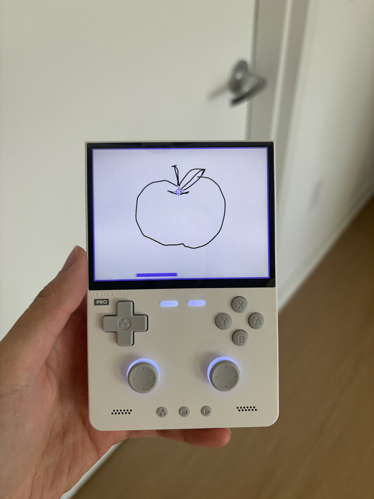
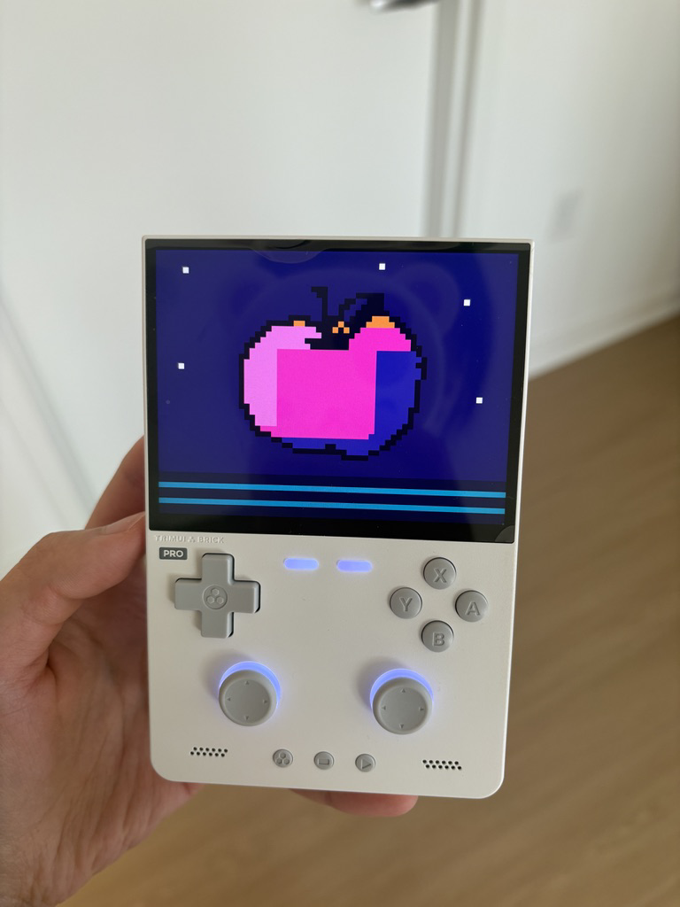
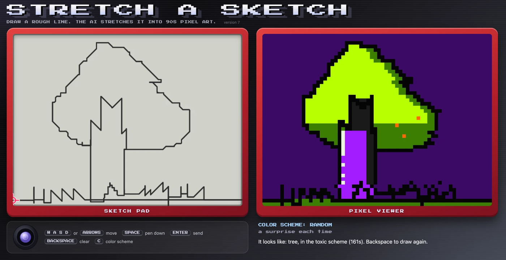
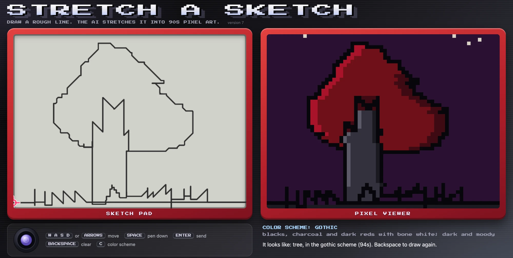

# Stretch a Sketch

*Draw a rough line. The AI stretches it into 90s pixel art.*

- **Device**: TrimUI Brick Pro (Allwinner A133p, 1GB RAM, 64GB SD card)
- **Model(s)**: Claude Sonnet 5.5 (via Claude Code)
- **Status**: working prototype. Draw on the handheld, the node colours it in, and the pixel art comes back to the handheld's screen

## What this is

An Etch A Sketch for a retro Linux handheld. Draw with the two joysticks, and the app turns every sketch into 90s video-game pixel art, with button options to customize the look. My own cloud node asks Claude to redraw each sketch as a pixel grid, then renders the result.

Read the full plan in [PLAN.md](PLAN.md).

## What works so far

The whole loop runs: you draw with the sticks on the Brick Pro, press A, and about one to three minutes later the pixel art fills the handheld's screen.

<table>
<tr>
<td align="center"></td>
<td align="center"></td>
</tr>
<tr>
<td align="center"><b>1. Drawn on the handheld</b><br>The purple bar means the sketch is on its way to the node</td>
<td align="center"><b>2. Pixel art comes back</b><br>Same screen, a couple of minutes later</td>
</tr>
</table>

**On the handheld** (`device/`): a small C program, built static on the node so it needs no libraries and runs on the handheld's older Linux. It draws straight to the screen and reads the sticks directly. Left stick, right stick and D-pad all move the pen at the same speed. The border shows the mode: blue while you pick a start point, red while drawing, purple while waiting for the node, orange if something went wrong (your sketch stays, so you can send again).

| Button | Does |
| --- | --- |
| A | first press puts the pen down, second press sends the sketch |
| B | clears (and starts a new drawing after the art is shown) |
| hold L1 + R1 | quits |

Sending is done by `send.sh`, which uses the handheld's own `curl` to post the pen points to the node, check on the job every two seconds, and download the finished picture as plain text. The node address and a secret token live in a `server.conf` file on the SD card, so they can change without rebuilding.

**On the node** (`src/`): a small server takes the pen points, turns them into a sketch, and has Claude colour it in as a 64 by 48 pixel grid, tracing the player's lines. The code checks the grid (size and palette), retries if it is wrong, and renders it. It is open to the internet on one port, but only answers requests that carry the secret token.

**On the laptop** (`web/`): a simulator (two matching red windows, a stretched pixel-game title, and an on-screen joystick that tilts as you press keys) lets me draw with the keyboard or a game controller and see the result. It fits one screen with no scrolling.

<table>
<tr>
<td align="center"></td>
<td align="center"></td>
</tr>
<tr>
<td align="center"><sub>The same sketch in the toxic scheme (161 s)</sub></td>
<td align="center"><sub>and in the gothic scheme (94 s)</sub></td>
</tr>
</table>

```
scripts/forge.sh test               # copy the code to the node and run the tests there
scripts/forge.sh draw sketch.png    # redraw a sketch as pixel art; results land in out/
scripts/forge.sh serve              # run the server on the node, then open http://localhost:8765
scripts/build-device.sh sketch      # build the handheld app on the node (static, arm64) into device/bin/
```

Getting it onto the handheld (USB Data mode, `adb`): copy the files in `device/StretchSketch/` and the built `sketch` binary to `/mnt/SDCARD/Apps/StretchSketch/`, put the node's address and token in `server.conf` there, then restart the handheld's menu so it finds the app. The node's `scripts/start-server.sh` runs the server with the token (kept in a `.token` file on the node, never in this repo).

Still to do: the color-scheme button on the handheld, more testing on the device, and a nicer icon.

### Real results so far

Top row: the sketches. Bottom row: what Claude on my node made from each one, colouring in the lines exactly where they were drawn, in a different color scheme each time (named under each picture). The sketches are test drawings made by a script to look like joystick lines, so these are the node's results before the handheld was connected. Each took between 58 and 96 seconds at low effort.

<table>
<tr><td align="center"></td><td align="center"></td><td align="center"></td><td align="center"></td><td align="center"></td></tr>
<tr><td align="center"><br><sub>gothic</sub></td><td align="center"><br><sub>pastel</sub></td><td align="center"><br><sub>synthwave</sub></td><td align="center"><br><sub>mono</sub></td><td align="center"><br><sub>gameboy</sub></td></tr>
</table>

The code is in `src/`, the tests in `tests/`, and `CLAUDE.md` is the briefing the AI reads first.

Semester project for PSAM 5600 B: Small Linux Devices, Large Language Models (Parsons School of Design, Fall 2026). Course index card: [mfadt/sld-fall-2026/projects/floracao111.md](https://github.com/mfadt/sld-fall-2026/blob/main/projects/floracao111.md)

Inspired by the classic Etch A Sketch toy, a trademark of its owner. This project is not affiliated with it.

## Attribution

All coursework here is co-authored with AI models per course policy. See commit history for `Co-Authored-By:` trailers naming each model that contributed.
