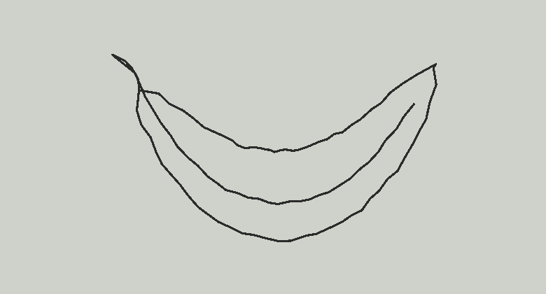
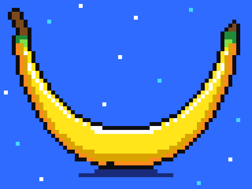
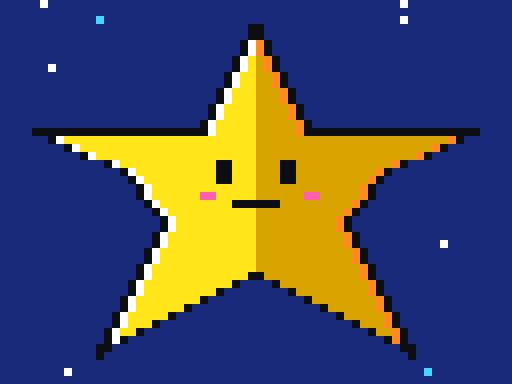
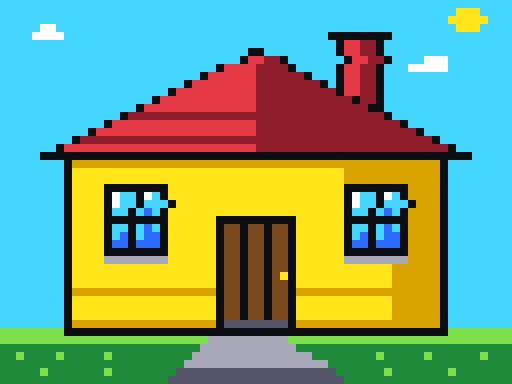
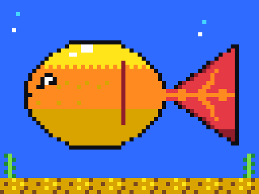

# Stretch a Sketch

*Draw a rough line. The AI stretches it into 90s pixel art.*

- **Device**: TrimUI Brick Pro (Allwinner A133p, 1GB RAM, 64GB SD card)
- **Model(s)**: Claude Sonnet 5.5 (via Claude Code)
- **Status**: prototype (node side works; handheld app not built yet)

## What this is

An Etch A Sketch for a retro Linux handheld. Draw with the two joysticks, and the app turns every sketch into 90s video-game pixel art, with button options to customize the look. My own cloud node asks Claude to redraw each sketch as a pixel grid, then renders the result.

Read the full plan in [PLAN.md](PLAN.md).

## What works so far

On my Oracle node, a small server takes pen points, turns them into a sketch, and has Claude redraw it as a 64 by 48 pixel grid. The code checks the grid (size and palette), retries if it is wrong, and renders it as a PNG. A laptop test page lets me draw with the keyboard or a game controller and see the result. The handheld app and getting code onto the Brick Pro are not built yet.

```
scripts/forge.sh test               # copy the code to the node and run the tests there
scripts/forge.sh draw sketch.png    # redraw a sketch as pixel art; results land in out/
scripts/forge.sh serve              # run the server on the node, then open http://localhost:8765
```

### Real results so far

Top row: the sketches. Bottom row: what Claude on my node drew from each one, with its own choice of colors and background. The banana sketch was drawn for the plan; the other three are test sketches made by a script to look like joystick lines. The star, house and fish took 72 to 106 seconds at low effort; the banana was an earlier run that took about three minutes.

<table>
<tr>
<td></td>
<td></td>
<td></td>
<td></td>
</tr>
<tr>
<td></td>
<td></td>
<td></td>
<td></td>
</tr>
</table>

The code is in `src/`, the tests in `tests/`, and `CLAUDE.md` is the briefing the AI reads first.

Semester project for PSAM 5600 B: Small Linux Devices, Large Language Models (Parsons School of Design, Fall 2026). Course index card: [mfadt/sld-fall-2026/projects/floracao111.md](https://github.com/mfadt/sld-fall-2026/blob/main/projects/floracao111.md)

Inspired by the classic Etch A Sketch toy, a trademark of its owner. This project is not affiliated with it.

## Attribution

All coursework here is co-authored with AI models per course policy. See commit history for `Co-Authored-By:` trailers naming each model that contributed.
